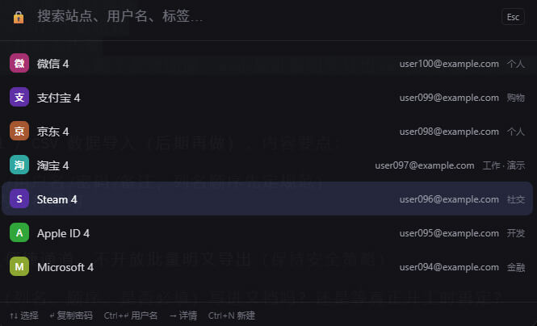
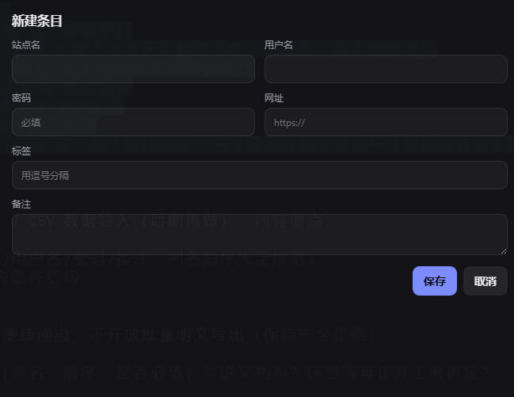
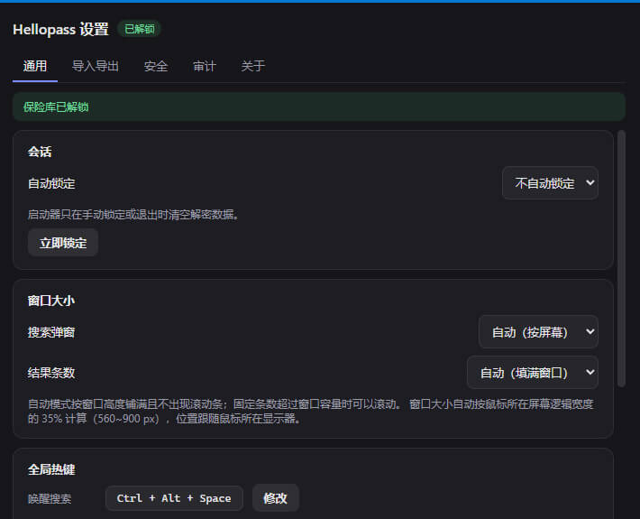

# Hellopass 密码管理器

跨平台密码管理器，采用 Vue 3 + Rust + Tauri 2 架构；密码使用 AES-256-GCM 加密，主密钥由 PBKDF2-HMAC-SHA256（600,000 次迭代）从主密码派生。

当前版本：**v1.0.1**

> [!IMPORTANT]
> - 🤖 **AI 生成项目**：本项目代码由 AI 辅助生成，仅供学习、参考与二次开发使用。
> - 💾 **本地密码存储**：所有数据经 AES-256-GCM 加密后仅保存在本地设备，**不会上传至任何服务器**。

## 🚀 使用方式

- 启动后常驻托盘，不显示主窗口。
- 按 `Ctrl+Alt+Space` 唤出搜索窗，`Ctrl+Shift+L` 立即锁定（两个热键都可在设置窗里自由改键，录制期间会临时注销）：输入即搜（支持拼音首字母，如 `wx` → 微信），`↑↓` 选择，`Enter` 复制密码并收起（30 秒后自动清剪贴板），`Ctrl+Enter` 复制用户名，`→` 查看详情，`Ctrl+N` 新建。
- 托盘菜单：搜索 / 立即锁定 / 设置… / 退出；导入导出统一在设置窗里完成。
- 设置窗包含窗口大小（自动/紧凑/标准/大）、结果条数（自动填满/固定 N 条）、自动锁定时长、修改主密码、导入导出、备份恢复、完整性检查与审计日志。

## ✅ 已完成

- **CSV 导入**：支持本程序导出格式与浏览器导出的 `name, url, username, password, note` 列名
  （表头忽略大小写，支持 BOM / CRLF / 引号内换行）；按「名称 + 网址 + 用户名」识别，
  同一站点可保留多个账号，已存在则用新密码覆盖

## ⏳ 未完成（按处理顺序）

1. 真机 / CI 实际运行验证（`github/workflows/ci.yml` 已配置三平台矩阵，需推送触发）
2. 跨设备自动同步（当前用加密备份/恢复实现手工迁移）
3. 更大规模的模糊测试 / 渗透测试
4. 固定格式 Excel（.xlsx）数据导入（后期再做）
   - 计划支持从**固定模板**的 Excel 导入密码条目（列如：网站名称 / URL / 用户名 / 密码 / 备注，列名与顺序先定规范）
   - 复用「名称 + 网址 + 用户名」识别逻辑（同一站点可保留多个账号），已存在则覆盖，返回新增 / 覆盖 / 跳过统计
   - 明文 Excel 仅作导入便捷通道，**不开放批量明文导出**（保持现有安全策略）

## 🔐 安全参数

- 主加密：AES-256-GCM
- 密钥派生：PBKDF2-HMAC-SHA256（600,000 次）
- 密钥长度：256 位
- 明文存储：网站名称、URL、用户名；密码与备注加密存储
- 文件权限：600
- 主密码：最少 12 位，含大小写、数字、特殊字符
- 会话：30 秒空闲超时（最大 5 分钟），5 次失败锁定 30 分钟
- 密码历史：5 条（主密钥加密存储）；过期：90 天
- 敏感内存：主密钥与解密缓冲区用 `zeroize` 在释放时清零

## 📸 截图

## 许可证

本项目采用 **BSD 3-Clause License**，见 [LICENSE](LICENSE)。
第三方组件与许可证全文见 [THIRD_PARTY_LICENSES.md](THIRD_PARTY_LICENSES.md)。

---
最后更新：2026-11-12
