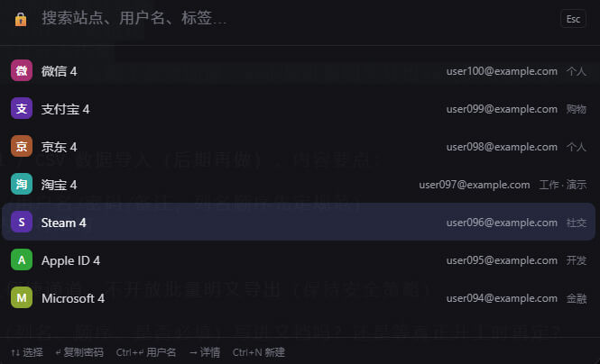
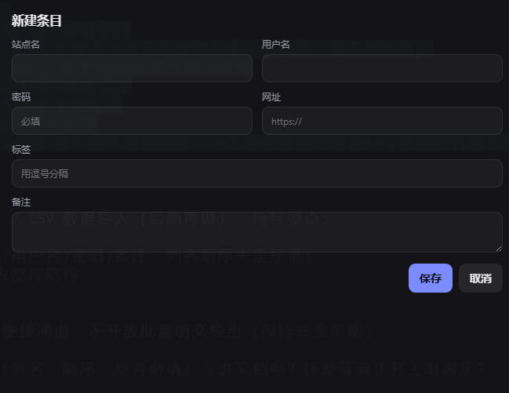
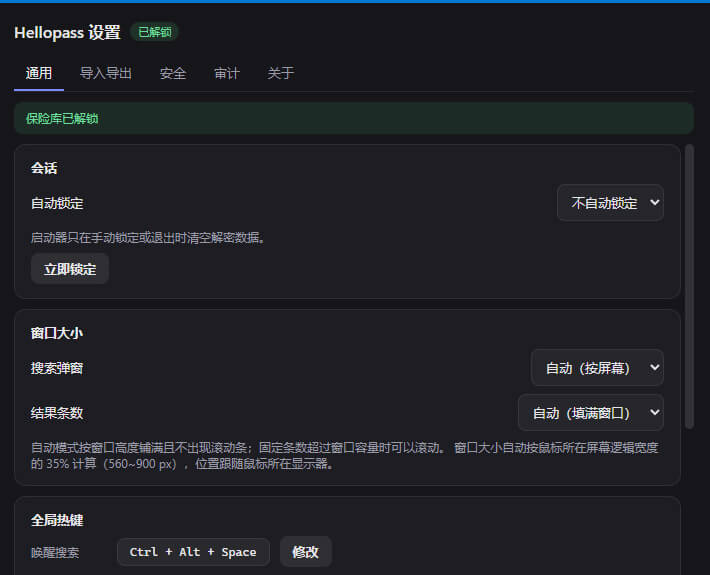

# Hellopass — Secure Password Manager

Hellopass is a cross-platform password manager built with Vue 3 + Rust + Tauri 2.
All passwords are encrypted with **AES-256-GCM**, and the master key is derived
from your master password using **PBKDF2-HMAC-SHA256 (600,000 iterations)**.

---

## 1. Quick Start (Windows portable build)

1. Unzip `Hellopass-<version>-win64.zip`.
2. Double-click **`Hellopass.exe`**.
   - Requires the system **WebView2 Runtime** (built into Windows 11 and recent
     Windows 10). If you use the offline build with a bundled runtime, run
     **`Hellopass.cmd`** instead.
   - The app runs in the **system tray**; no main window pops up.
3. On first launch you'll be asked to set a **master password**:
   - At least **12 characters**, with upper- and lower-case letters, digits, and
     a special character.
4. Press `Ctrl+Alt+Space` to open the search window and start using it.

> The build is **not code-signed**. Windows SmartScreen may show an "unknown
> publisher" warning — click **More info → Run anyway** to proceed.

---

## 2. Basic Usage

### Hotkeys (default)

| Key | Action |
| --- | --- |
| `Ctrl+Alt+Space` | Open the search window |
| `Ctrl+Shift+L` | Lock immediately |
| `↑` / `↓` | Move selection |
| `Enter` | Copy password and collapse (clipboard auto-clears after 30s) |
| `Ctrl+Enter` | Copy username |
| `→` | View entry details |
| `Ctrl+N` | Create a new entry |

- **Search as you type.** Supports pinyin initials, e.g. `wx` → 微信 (WeChat).
- Both hotkeys can be **rebound** in the Settings window (they are temporarily
  released while recording a new combination).

### Tray menu

Right-click the tray icon for: **Search / Lock now / Settings… / Quit**.
Import and export are handled inside the Settings window.

### Settings window

Open it from the tray menu. It includes:

- Window size (auto / compact / standard / large)
- Result count (auto-fill / fixed N)
- Auto-lock duration
- Change master password
- Import / export
- Backup / restore
- Integrity check and audit log

---

## 3. Screenshots





## 4. Where your data lives

```
%APPDATA%\com.hellopass.app\
├── hellopass.db                              # encrypted vault
└── config\
    ├── master_password_config.json           # salt + verification token
    └── hotkey.json                           # hotkey bindings
```

The database file is stored with `0600` permissions. Site names, URLs, and
usernames are stored in plaintext; **passwords and notes are encrypted**.

> Deleting `Hellopass.exe` does **not** delete your data. To fully wipe, remove
> the `%APPDATA%\com.hellopass.app` folder.

---

## 5. Security at a glance

- **Encryption:** AES-256-GCM (authenticated, tamper-resistant)
- **Key derivation:** PBKDF2-HMAC-SHA256, 600,000 iterations, 256-bit key
- **Master password:** ≥12 chars, mixed case + digits + special char
- **Session:** idle auto-lock (default 30s, up to 5 min); 5 failed attempts →
  30-minute lockout
- **Sensitive memory:** master key and decrypted buffers are zeroized on free
- **Backups:** encrypted `.spb` export / self-contained encrypted backup

If you forget your master password, the data **cannot be recovered** — export an
encrypted `.spb` backup regularly.

---

## 6. Build from source (developers)

### Requirements

- Rust 1.70+
- Node.js 18+
- Tauri 2 CLI
- Linux: `webkit2gtk-4.1` and `libdbus-1-dev`

### Run in development

```bash
npm install --prefix frontend
cargo install tauri-cli --version ^2.0.0
cargo tauri dev
```

### Headless core tests (no GUI)

```bash
cargo test --bin hellopass_cli --no-default-features
```

### Package the Windows portable build (from Linux/WSL)

```bash
./scripts/package-win.sh                 # depends on system WebView2
./scripts/package-win.sh --with-webview2 # bundles an offline WebView2 runtime
```

---

## 7. Planned (not yet implemented)

- **Fixed-format Excel (.xlsx) / CSV import (later)**
  - Import password entries from a **fixed template** for Excel and CSV
    (columns such as: site name / URL / username / password / notes; column
    names and order to be spec'd up front).
  - CSV parsed with UTF-8 (BOM); Excel parsed into the same internal row
    structure.
  - Reuses the existing "site name + username" deduplication and returns
    added / skipped counts.
  - Plaintext Excel/CSV is an import-only convenience channel — **no bulk
    plaintext export** (keeps the current security policy).

## 8. License

This project is licensed under the **BSD 3-Clause License** — see
[LICENSE](LICENSE). Third-party licenses are listed in
[THIRD_PARTY_LICENSES.md](THIRD_PARTY_LICENSES.md).

---
Last updated: 2026-11-10
